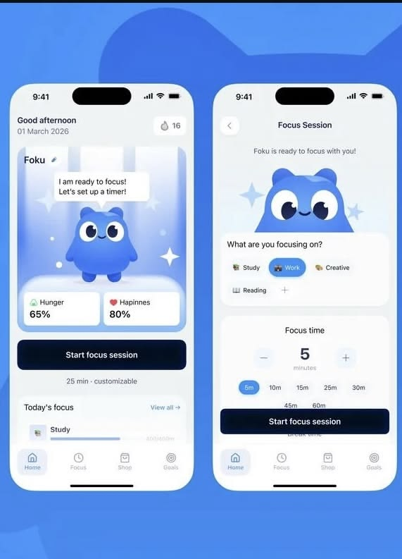
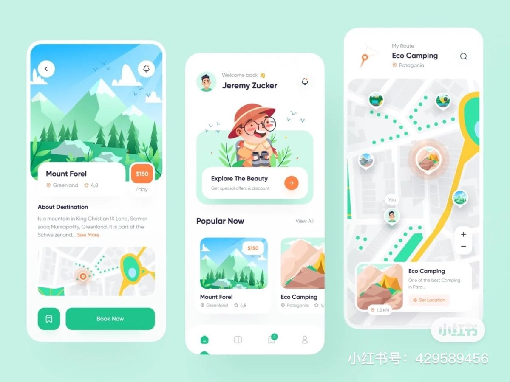

# References

Materi referensi visual untuk Constella.

## ref-01-foku-soft-ui-mascot.png

**Sumber:** dilampirkan pengguna bersama PRD, 13 November 2026.
**Produk pada gambar:** "Foku" — aplikasi pihak ketiga, bukan milik proyek ini.

**Dipakai sebagai acuan untuk:**

| Elemen | Yang diambil |
|---|---|
| Maskot | Bentuk blob 3D soft, mata besar, warna biru, melayang. Acuan gaya karakter untuk Cosmic Mascot (lihat `docs/04-features-mvp.md` §4.4) |
| Speech bubble | Kartu putih rounded dengan ekor, dipakai untuk onboarding maskot |
| Chip kategori | Pil pastel biru dengan ikon emoji — acuan untuk pemilih kategori fokus |
| Chip durasi | Pil kecil 5m / 10m / 15m / 25m / 30m / 45m / 60m, satu terpilih berwarna penuh |
| Angka timer | Angka besar rounded dengan tombol minus dan plus di kiri-kanan |
| Tombol utama | Kapsul Navy lebar penuh — acuan `action/primary` |
| Kartu statistik | Kartu rounded putih dengan label dan persentase besar |
| Progress bar | Bar tipis rounded untuk Today's Focus — acuan Stardust Energy |
| Tab bar | Empat tab dengan ikon garis dan satu tab aktif berlatar pill |
| Latar | Biru pastel dengan bentuk blob besar di belakang |

**Yang TIDAK diambil:**

- Nama "Foku", branding, dan bentuk maskot persisnya. Constella memerlukan karakter orisinal. Lihat `docs/06-open-questions.md` #17.
- Metrik Hunger dan Happiness — model gamifikasi Constella berbasis Stardust Energy, bukan pemeliharaan hewan peliharaan.
- Struktur informasi layar Home secara keseluruhan; Constella berpusat pada kamera AR, bukan pada dashboard.

## ref-02-eco-camping-illustrated-cards.png

**Sumber:** dikirim pengguna, 15 November 2026, sebagai acuan arah animasi dan
kepadatan visual. Watermark Xiaohongshu 429589456 ada pada gambar aslinya.
**Produk pada gambar:** aplikasi perjalanan pihak ketiga, bukan milik proyek ini.

**Dipakai sebagai acuan untuk:**

| Elemen | Yang diambil |
|---|---|
| Kartu bergambar | Kartu rounded dengan ilustrasi penuh di atas dan teks di bawah — acuan kartu bintang dan kartu rasi |
| Ilustrasi datar | Gaya ilustrasi bidang datar berlapis, bukan foto — acuan latar dekoratif |
| Kartu mengambang | Kartu putih yang naik di atas latar berwarna dengan bayangan lembut |
| Pil aksi | Tombol kapsul berwarna penuh dengan ikon lingkaran di ujung |
| Peta berpenanda | Penanda bulat berisi gambar kecil di atas jalur bertitik — acuan penanda bintang di peta langit |
| Kepadatan | Satu layar memuat beberapa kartu berukuran berbeda, bukan satu blok besar |

**Yang TIDAK diambil:**

- Palet hijau mint gambar ini sendiri tidak disalin. Tetapi arah warnanya
  **ternyata diambil**: pada 15 November 2026 pemilik produk mengirim palet
  teal-mint terpisah, dan palet itulah yang dipakai. Lihat
  `ref-03-teal-mint-palette` di bawah.
- Struktur navigasi dan fiturnya: pemesanan, rute, dan profil tidak ada di
  Constella. Gambar ini menentukan tampilan, bukan fitur maupun navigasi.
- Ilustrasi manusia bergaya kartun. Maskot Constella satu-satunya karakter.

## ref-03-teal-mint-palette

**Sumber:** dikirim pengguna, 15 November 2026, sebagai tangkapan layar sebuah
pemilih palet daring. Gambarnya sendiri tidak disimpan di repo karena tidak
memuat apa pun selain empat petak warna; nilainya yang penting, dan nilai itu
ditulis di sini supaya tidak hilang.

| Nama | Nilai |
|---|---|
| Teal tua | `#287A74` |
| Teal | `#55A9A0` |
| Mint | `#AEEED3` |
| Kuning pucat | `#FFF8B0` |

**Dipakai sebagai acuan untuk:** seluruh palet aplikasi, menggantikan keluarga
biru-navy. Pemetaan lengkap ke token ada di
[`../docs/03-design-system.md`](../docs/03-design-system.md) §3.1.

**Yang TIDAK diambil:**

- Dominasi warnanya. Permintaan pengguna tegas: **putih tetap dominan.** Keempat
  warna ini aksen, bukan cat dinding. `backgroundPrimary` tetap putih murni dan
  `backgroundSecondary` hanya bersemu mint.
- Urutan dan proporsi petaknya. Gambar itu pemilih palet, bukan rancangan layar;
  luas tiap petak di sana tidak berarti apa-apa soal seberapa sering warnanya
  dipakai.
- Warna langit di layar AR. Selubung malam dan titik bintang tetap seperti
  adanya, karena itu warna langit, bukan warna merek.
